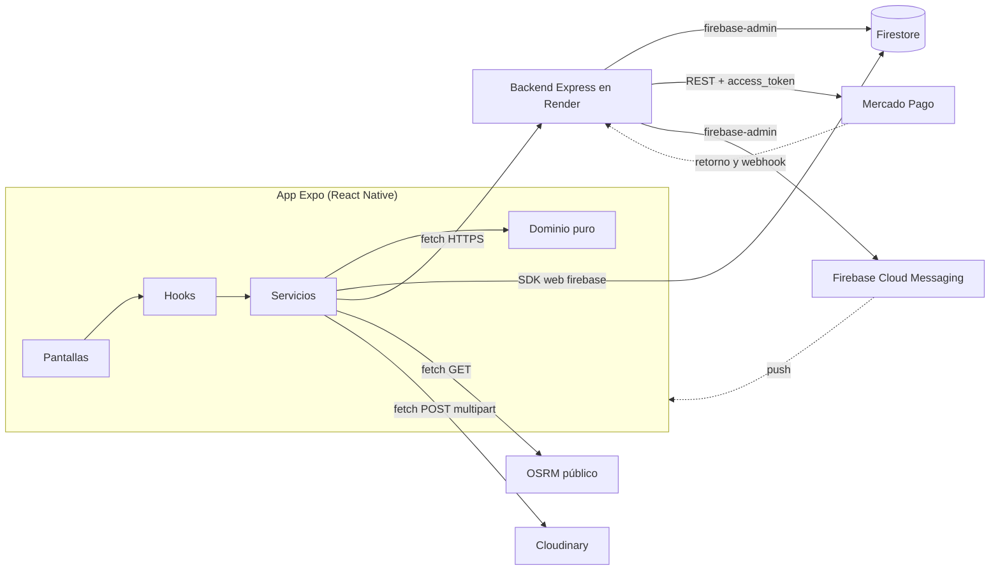
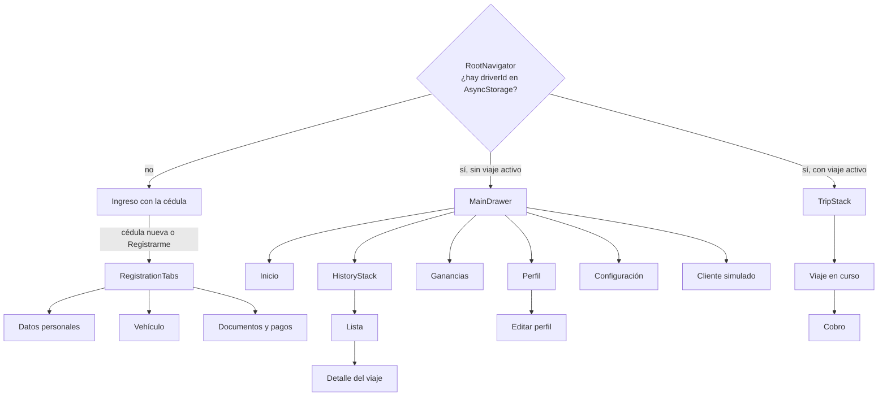
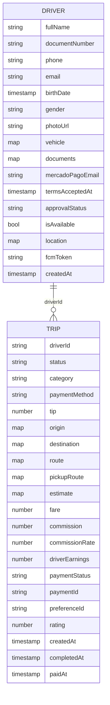
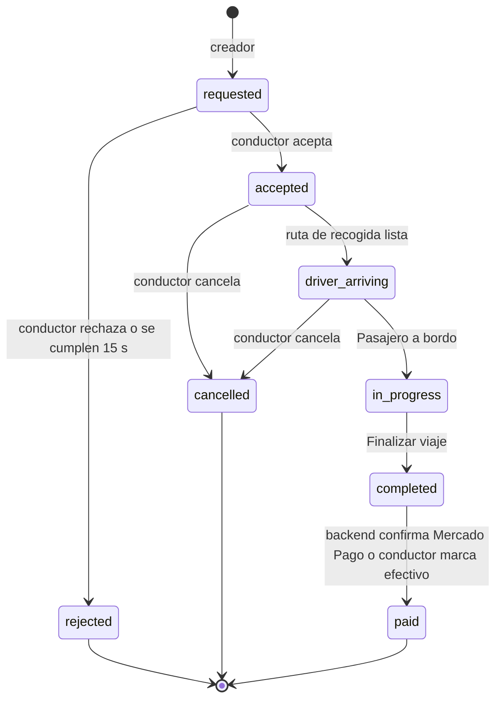
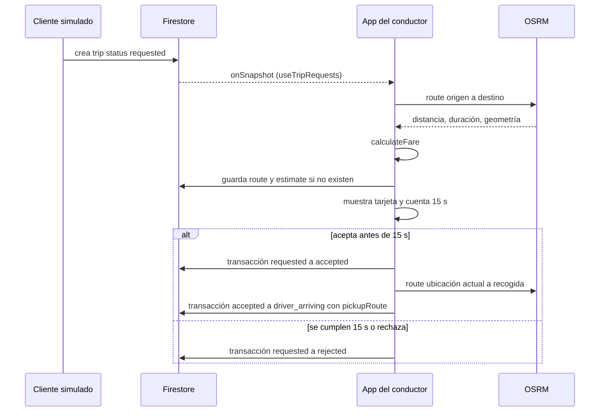
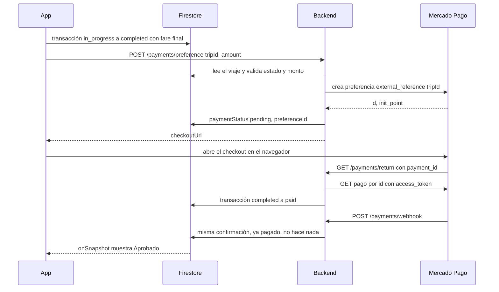

# UberClone Conductor: diseño del sistema

Segunda fase del ciclo de vida. Los requisitos dicen qué hace la app ([[Recurso - UberClone Conductor - 01 Requisitos]]); aquí defino cómo se construye: las piezas del sistema, cómo se hablan, dónde vive cada dato y qué pasa cuando algo falla. Los identificadores RF, RN, RNF y VA son los de los requisitos.

## 1. Atributos de calidad que guían el diseño

Ordené las prioridades porque varias decisiones se contradicen entre sí y necesito saber cuál gana.

| Prioridad | Atributo | Qué significa en esta app |
|---|---|---|
| 1 | Integridad del dinero | Una tarifa, una comisión o un saldo nunca quedan mal calculados ni se aplican dos veces. |
| 2 | Seguridad de los secretos | Ninguna llave secreta llega al teléfono ni a Git. |
| 3 | Consistencia del viaje | Un viaje nunca salta de estado ni queda en dos estados a la vez, aunque dos acciones choquen. |
| 4 | Costo cero | Todo cabe en planes gratuitos y sin tarjeta. |
| 5 | Mantenibilidad | Las reglas de negocio viven en un solo lugar y se prueban sin abrir la app. |
| 6 | Tiempo real | Solicitudes, estado del viaje y estado del pago aparecen sin recargar. |

## 2. Vista general

El sistema tiene cinco piezas propias o externas. Firestore es la fuente de verdad del estado; el backend solo existe para lo que necesita una credencial secreta.



| Pieza | Responsabilidad | Qué no hace |
|---|---|---|
| App | Interfaz, validaciones, cálculo de tarifa, transiciones del viaje, ubicación, rutas | No guarda secretos ni confirma pagos de Mercado Pago |
| Firestore | Estado de conductores y viajes, tiempo real | No tiene lógica, salvo las reglas de seguridad |
| Backend | Crear la preferencia de pago, confirmar pagos, crear solicitudes desde Postman, enviar push | No duplica el CRUD que la app ya hace contra Firestore |
| OSRM | Distancia, duración y geometría de una ruta | Nada más |
| Cloudinary | Guardar fotos y devolver su URL | Nada más |

## 3. Decisiones de arquitectura

Cada decisión trae la alternativa que descarté y la razón, para poder revisarla si cambian las condiciones.

| ID | Decisión | Alternativa descartada | Por qué |
|---|---|---|---|
| AD-01 | En la app separo cuatro capas: pantallas, hooks, servicios y dominio. Una pantalla nunca importa Firestore ni hace `fetch`. | Lógica dentro de las pantallas | Con la lógica en las pantallas, la misma regla termina copiada en tres lugares y no se puede probar sin la interfaz. |
| AD-02 | Firestore es la fuente de verdad y la app escribe directo con el SDK web. El backend solo atiende lo que necesita un secreto. | Una API REST propia para todo el CRUD | Con una API para todo escribo el doble de código y pierdo el tiempo real de `onSnapshot`, que es justo lo que pide el flujo de solicitudes. |
| AD-03 | Cada cambio de estado del viaje pasa por `runTransaction` y por un mapa de transiciones permitidas en `tripStateMachine.js`. | `updateDoc` directo | El temporizador de 15 s y el botón Aceptar pueden escribir en el mismo instante. La transacción relee el estado y solo una de las dos gana. |
| AD-04 | El vehículo y los documentos van embebidos en el documento del conductor. Los viajes van en una colección raíz `trips` con `driverId`. | Subcolecciones `drivers/{id}/trips` | El vehículo se lee siempre junto al conductor (relación 1 a 1). Los viajes en la raíz permiten que el backend los busque solo por `tripId`, que es lo que devuelve Mercado Pago. |
| AD-05 | Rutas con el servidor público de OSRM. Guardo en el viaje la geometría simplificada (`overview=simplified`). | Directions y Distance Matrix de Google | Google exige facturación con tarjeta. La geometría completa puede traer miles de puntos y acercarse al límite de 1 MiB por documento. |
| AD-06 | La tarifa final usa la distancia y la duración de la ruta cotizada al crear la solicitud. | Medir la distancia real con el GPS | El pasajero acepta el precio que vio. En las pruebas el teléfono no se mueve y el GPS daría 0 km. El GPS también mete ruido que habría que filtrar. |
| AD-07 | El backend confirma un pago consultando a Mercado Pago con su `access_token` y lo aplica una sola vez dentro de una transacción. | Creer en el `status` que llega en la URL de retorno o en el cuerpo del webhook | Cualquiera puede escribir `?status=approved` en una URL o mandar un POST falso. Si consulto el pago con mi llave, el dato viene de Mercado Pago. |
| AD-08 | Las fotos suben directo de la app a Cloudinary con un preset sin firma, limitado a una carpeta y a formatos de imagen, con una transformación de entrada que reduce las fotos a 1600 px como máximo. Cloudinary no deja fijar un peso máximo en el preset, así que la app comprime la foto al elegirla (`quality` 0,6) y rechaza las de más de 5 MB. | Subida firmada a través del backend | La subida firmada es más segura, pero hace que el registro dependa de que el backend esté despierto. El preset restringido limita el abuso posible a subir imágenes a esa carpeta. |
| AD-09 | Estado global con `useContext`: sesión del conductor, preferencias y formulario de registro. | Redux | Tengo tres estados globales y ninguno con lógica compleja. El resto del estado vive en Firestore y llega por hooks. |
| AD-10 | El módulo de notificaciones (`expo-notifications`) se carga con `require` dentro de una función, solo en Android y fuera de Expo Go. | Importarlo arriba del archivo | Expo Go en Android no recibe notificaciones remotas desde el SDK 53, y pedir el token ahí falla. Con el `require` dentro de la función, Expo Go nunca abre el módulo. |
| AD-11 | Un solo repositorio: la app en la raíz y el backend en `backend/`. Render despliega con "Root Directory" en `backend`. | Dos repositorios | Un cambio que toca el contrato de la API queda en un solo commit, con la app y el backend juntos. |
| AD-12 | Todo el dinero se maneja en pesos enteros y se redondea en un solo punto, dentro de `calculateFare`. | Decimales con redondeo al mostrar | Con decimales, la suma de comisiones del mes puede no cuadrar con la de cada viaje (RN-05). |
| AD-13 | El mapa es Leaflet 1.9.4 dentro de `react-native-webview`, con teselas de OpenStreetMap. Solo `RouteMap` conoce Leaflet: recibe `center`, `markers` y `route` por props y los pasa a la página con `injectJavaScript`. | `react-native-maps` con Google; MapLibre nativo | Google exige una cuenta de facturación para activar la llave del APK. MapLibre no corre en Expo Go y me obligaría a recompilar con EAS en cada cambio nativo. El WebView viene en Expo Go y en el APK funciona igual, sin llave. |

## 4. Estructura del proyecto

```
uberclone-conductor/
├── App.js                      # Proveedores de contexto + RootNavigator
├── app.config.js               # Config de Expo, package de Android y plugins
├── .env.example                # Variables EXPO_PUBLIC_* sin valores
├── google-services.json        # App de Android en Firebase, para FCM. No se sube a Git
├── firestore.rules             # Reglas de seguridad versionadas
├── firestore.indexes.json      # Los dos índices compuestos de la sección 6
├── src/
│   ├── config/
│   │   ├── pricing.js          # RN-04: base, km, min, mínima, multiplicadores, comisión
│   │   ├── app.js              # Intervalos, tiempos de espera, tamaño de página, URLs desde env
│   │   └── firebase.js         # initializeApp + getFirestore
│   ├── domain/                 # Funciones puras: sin React, sin red, sin Firestore
│   │   ├── fare.js             # calculateFare (RN-01 a RN-06)
│   │   ├── tripStateMachine.js # Transiciones permitidas (RN-09)
│   │   ├── validators.js       # VA-01 a VA-20, devuelven una clave de error o null
│   │   ├── dateRanges.js       # Hoy, semana (lunes a domingo), mes, rango
│   │   ├── earnings.js         # Saldo y resumen de un periodo: viajes, facturado, comisiones, propinas, neto, promedio
│   │   ├── driverProfile.js    # Formulario validado + URL de fotos → documento del conductor
│   │   ├── payment.js          # Monto a cobrar, estado del pago, errores del backend, calificación
│   │   └── requestExpiry.js    # Qué solicitud ya venció al abrir Inicio (RF-13)
│   ├── services/
│   │   ├── driverService.js    # CRUD de drivers en Firestore
│   │   ├── tripService.js      # CRUD y transiciones de trips en Firestore
│   │   ├── apiService.js       # fetch al backend, manejo uniforme de errores
│   │   ├── routeService.js     # OSRM: ruta, distancia, duración
│   │   ├── uploadService.js    # Cloudinary
│   │   ├── notificationService.js # Token FCM, carga condicional (AD-10)
│   │   └── storageService.js   # AsyncStorage: sesión y preferencias
│   ├── hooks/
│   │   ├── useDriverLocation.js
│   │   ├── useTripRequests.js
│   │   ├── useActiveTrip.js
│   │   ├── useTripProgress.js  # Ruta de recogida y cambios de etapa del viaje
│   │   ├── usePayment.js       # Checkout, verificar pago, efectivo y calificación
│   │   ├── useEarnings.js
│   │   ├── useTripHistory.js
│   │   ├── useTrip.js          # Un viaje del historial, para el detalle
│   │   ├── useDriverForm.js    # Valores, errores y fotos del formulario del conductor (registro y Perfil)
│   │   ├── useProfileEdit.js   # Editar contacto, Renovar documentos y Editar perfil: cada uno valida y escribe solo sus campos
│   │   ├── usePushNotifications.js # Guarda el token de FCM; tocar la notificación abre Inicio
│   │   └── useCountdown.js
│   ├── context/
│   │   ├── SessionContext.js   # driverId + documento del conductor en tiempo real
│   │   ├── SettingsContext.js  # Idioma, última disponibilidad, función t()
│   │   └── RegistrationContext.js # Estado del formulario de las tres pestañas
│   ├── navigation/
│   │   ├── RootNavigator.js
│   │   ├── RegistrationTabs.js
│   │   ├── MainDrawer.js
│   │   ├── TripStack.js
│   │   ├── HistoryStack.js
│   │   └── ProfileStack.js
│   ├── screens/                # Una carpeta por módulo: registration, home, trip, payment...
│   ├── components/             # FormField, SelectField, DateField, CheckboxField, PhotoPicker,
│   │                           # DriverFormFields (los campos del conductor por grupo),
│   │                           # FieldError, FormScrollView, formStyles, RequestCard, RouteMap, StatusBadge,
│   │                           # EmptyState, ErrorState, LoadingState, InfoRow
│   └── i18n/
│       ├── es.js
│       ├── en.js
│       └── format.js           # Pesos y kilómetros con los separadores de cada idioma
└── backend/
    ├── package.json
    ├── .env.example
    ├── test/                   # node --test, con Mercado Pago y Firestore de mentira
    └── src/
        ├── index.js            # Express, rutas, manejador de errores
        ├── routes/
        │   ├── health.js
        │   ├── payments.js
        │   └── trips.js
        ├── services/
        │   ├── firebaseAdmin.js
        │   ├── mercadoPago.js  # fetch a la API REST de Mercado Pago
        │   ├── paymentConfirmation.js # Confirmación idempotente (AD-07)
        │   └── pushService.js
        └── middleware/
            ├── validate.js
            ├── simulatorKey.js
            └── errorHandler.js
```

**Regla de dependencias:** `screens → hooks → services → domain`, y `config` lo puede leer cualquiera. Ninguna capa importa a la de arriba. `domain/` no importa nada del proyecto salvo `config/`.

## 5. Navegación y pantallas



- **RootNavigator** decide con `SessionContext`. Mientras lee AsyncStorage muestra una pantalla de carga, para no mostrar el registro un instante a un conductor que ya tiene sesión.
- **LoginScreen** (RF-39) busca la cédula con `findDriverIdByDocument`: una igualdad sobre `documentNumber`, sin índice compuesto, con `getDocsFromServer` para no responder «no existe» solo porque el teléfono no tenía al conductor en caché. Si lo encuentra, guarda su id como sesión; si no, ofrece el registro y le pasa la cédula como parámetro de navegación.
- **RegistrationTabs** (RF-01): las tres pestañas comparten `RegistrationContext`. El botón "Enviar registro" está en las tres, y se habilita con un `useMemo` que valida el formulario completo (RF-03).
- **TripStack** reemplaza al Drawer mientras `useActiveTrip` encuentra un viaje en `accepted`, `driver_arriving`, `in_progress` o `completed`, o uno `paid` sin calificar. Si el conductor cierra la app a mitad de un viaje, al abrirla vuelve al viaje: la navegación sale del estado guardado en Firestore, no de la memoria. Con `completed` o `paid` muestra Cobro y antes, Viaje en curso. Si el viaje saliera de la consulta al pagarse, Cobro desaparecería antes de mostrar "Aprobado" y de pedir la calificación (RF-24, RF-25). Calificar cierra el viaje y devuelve al Drawer. Mientras busca el viaje, `RootNavigator` muestra la carga. Si hay dos viajes activos, atiende primero el que aceptó antes.
- **Perfil** (RF-33) muestra el documento del conductor en tiempo real: foto, estado de aprobación, datos personales, vehículo, documentos con su vencimiento y correo de Mercado Pago. Lo que deja cambiar depende del estado de la cuenta (`editsWholeProfile`), y la pantalla de edición recibe el modo por la navegación:
  - Con la cuenta aprobada, **Editar contacto** cambia el teléfono, el género, el correo y el correo de Mercado Pago (`validateContact`, `updateDriverProfile`), y la cuenta sigue aprobada. La identidad, el vehículo y la foto de perfil quedan fijos porque son lo que verificó el aprobador. Para corregirlos, el aprobador los cambia en la consola.
  - **Renovar documentos** se abre solo cuando la licencia, el SOAT o la revisión técnico-mecánica ya vencieron o les faltan menos de `RENEWAL_WINDOW_DAYS` (7) días (`documentsDueForRenewal`). Muestra solo esos documentos, vacíos, y pide la foto y el vencimiento del documento nuevo (`validateRenewal`). Si la fecha nueva vuelve a caer en la ventana, no la acepto. Al guardar, `submitForReview` escribe solo esos campos dentro de `documents`, devuelve la cuenta a `pending` y la deja No disponible.
  - Con la cuenta pendiente o rechazada, **Editar perfil** corrige todo el registro menos la foto de perfil. Valida con `validateProfile`, que son las reglas del registro sin la casilla de términos (HU-10), y `submitForReview` deja la cuenta en revisión. Así un conductor rechazado vuelve a enviar su registro.
  - En los tres casos sube a Cloudinary solo las fotos que cambiaron.
- **Inicio** no deja ponerse disponible con un documento vencido (`expiredDocuments`). Muestra cuáles vencieron y un botón a Renovar documentos.
- **Configuración** (RF-34, RF-35, RF-41) cambia el idioma sin reiniciar, cierra la sesión y elimina la cuenta. El idioma también se elige en la primera pestaña del registro. «Eliminar mi cuenta» se apaga mientras el conductor está Disponible. Al confirmar, `deleteDriver` borra el documento en una transacción que exige `isAvailable == false`, lo mismo que la regla, y `SessionContext.deleteAccount` vuelve al ingreso con el aviso «Eliminé tu cuenta». Marco el borrado antes de escribirlo: la escucha del conductor ve desaparecer el documento, a veces antes de que responda la transacción, y con la marca no lo confunde con una cuenta que quitó alguien más (`errors.accountGone`). Con un viaje abierto no se llega a esta pantalla, porque el Drawer no está montado.
- **Cliente simulado** es una pantalla del Drawer (D-01). Elige origen y destino de una lista de puntos fijos de Medellín, categoría, método de pago y propina. La categoría arranca en la del vehículo; si elijo otra, no crea el viaje y avisa que no hay conductores de esa categoría, porque el viaje no tendría a quién llegar. Desde la pantalla de Cobro abre el checkout y califica. Debajo del formulario, `PendingRequests` lista las solicitudes de este conductor que siguen en `requested`, con la misma consulta de `useTripRequests`, y deja retirarlas (RF-40). `withdrawRequest` borra el viaje en una transacción solo si sigue en `requested`: si el conductor lo acepta en el mismo instante, una de las dos transacciones falla sin escribir. Una solicitud retirada sale de Inicio porque deja de cumplir la consulta.

## 6. Modelo de datos



### `drivers/{driverId}`

| Campo | Tipo | Notas |
|---|---|---|
| `fullName`, `documentNumber`, `phone`, `email`, `gender` | string | VA-02 a VA-07 |
| `birthDate` | timestamp | VA-05 |
| `photoUrl` | string | URL de Cloudinary |
| `vehicle` | map | `category` (`economy`, `xl`, `premium`), `plate`, `brand`, `model`, `year`, `color`, `capacity`, `photoUrl` |
| `documents` | map | `licenseNumber`, `licensePhotoUrl`, `licenseExpiresAt`, `soatPhotoUrl`, `soatExpiresAt`, `techInspectionPhotoUrl`, `techInspectionExpiresAt` (los dos últimos `null` si no aplica) |
| `mercadoPagoEmail` | string | VA-19 |
| `termsAcceptedAt`, `commissionRateAccepted` | timestamp, number | VA-20: guardo qué porcentaje aceptó |
| `approvalStatus` | string | `pending`, `approved`, `rejected`. Lo aprueba o rechaza el aprobador desde la consola. La app solo lo devuelve a `pending` al renovar documentos o al corregir un registro sin aprobar |
| `isAvailable` | bool | |
| `location` | map | `latitude`, `longitude`, `updatedAt` |
| `fcmToken` | string o null | Token de FCM del teléfono. Solo existe en el APK; el backend lo borra si FCM responde que ya no sirve |
| `createdAt`, `updatedAt` | timestamp | `serverTimestamp()` |

El idioma y la última disponibilidad no van aquí: son preferencias del teléfono y viven en AsyncStorage (RNF-06).

### `trips/{tripId}`

| Campo | Tipo | Quién lo escribe | Notas |
|---|---|---|---|
| `driverId` | string | Creador | |
| `status` | string | App (transacción) y backend (`paid`) | RN-09 |
| `source` | string | Creador | `simulator` o `api` |
| `category`, `paymentMethod`, `tip` | string, string, number | Creador | `paymentMethod`: `mercadopago` o `cash` |
| `origin`, `destination` | map | Creador | `latitude`, `longitude`, `label` |
| `route` | map | App, al recibir la solicitud | `distanceKm`, `durationMin`, `coordinates` (origen a destino) |
| `pickupRoute` | map | App, al aceptar | Lo mismo, de la ubicación del conductor a la recogida |
| `estimate` | map | App, al recibir | `{ fare, commission, driverEarnings }` |
| `fare`, `commission`, `driverEarnings`, `commissionRate` | number | App, al finalizar | Valores finales. `commissionRate` cumple RN-07 |
| `paymentStatus` | string o null | Backend (`pending`, `approved`, `rejected`) o app (`cash`) | |
| `paymentId`, `preferenceId` | string | Solo el backend | |
| `rating` | number o null | Cliente simulado | 1 a 5 |
| `createdAt`, `acceptedAt`, `startedAt`, `completedAt`, `paidAt`, `cancelledAt`, `rejectedAt` | timestamp | Quien hace la transición | |

Las coordenadas de una ruta se guardan como arreglo de mapas `{ latitude, longitude }`, porque Firestore no admite arreglos dentro de arreglos y así `RouteMap` las recibe sin convertir.

### Índices compuestos

| Consulta | Campos del índice |
|---|---|
| Historial y ganancias | `driverId` ↑, `status` ↑, `completedAt` ↓ |
| Historial filtrado por método | `driverId` ↑, `status` ↑, `paymentMethod` ↑, `completedAt` ↓ |

La consulta de solicitudes (`driverId ==` y `status == 'requested'`) solo usa igualdades y no necesita índice; ordeno el resultado en el cliente. Los índices quedan en `firestore.indexes.json`.

### Consultas

| Hook | Consulta | Tipo |
|---|---|---|
| `useTripRequests` | `driverId == id`, `status == 'requested'` | `onSnapshot` |
| `PendingRequests` (Cliente simulado) | La misma de `useTripRequests` | `onSnapshot` |
| `useActiveTrip` | `driverId == id`, `status in [accepted, driver_arriving, in_progress, completed, paid]`, `rating == null` | `onSnapshot` |
| `useEarnings` | `driverId == id`, `status == 'paid'` | `onSnapshot` |
| `useTripHistory` | `driverId == id`, `status == 'paid'`, rango y método opcionales, `orderBy completedAt desc`, `limit 20`, `startAfter(último)` | `getDocs` por página |

El historial y las ganancias muestran solo viajes `paid`: los rechazados y cancelados no movieron dinero. Como todos están pagados, la etiqueta de cada viaje dice con qué se pagó («Efectivo» o «M. Pago») en vez del estado del pago. El saldo no se guarda en el conductor. `computeBalance` lo calcula con todos sus viajes pagados: suma `driverEarnings` de los que se pagaron con Mercado Pago y resta la `commission` de los que se pagaron en efectivo (RF-27). Si un viaje sale de Firestore, el saldo cambia en la siguiente lectura. A cambio, la escucha trae todos los viajes pagados del conductor y no solo los del mes.

En el resumen, facturado es la suma de `fare` sin propina, la ganancia neta suma `driverEarnings` y el promedio es la ganancia neta entre el número de viajes. La consulta de `useEarnings` solo usa igualdades y no necesita índice compuesto. El historial vuelve a pedir la primera página cuando el conductor entra desde el menú, y no cuando vuelve del detalle, para no perder las páginas que ya bajó.

### Presupuesto del plan gratuito

El plan gratuito de Firestore da 50.000 lecturas y 20.000 escrituras por día. Con la ubicación cada 5 segundos, una hora Disponible son 720 escrituras. Un viaje completo son unas 10 escrituras. Una jornada de pruebas de 4 horas con 20 viajes queda cerca de 3.100 escrituras, el 16 % del cupo.

## 7. Máquina de estados del viaje



`tripStateMachine.js` exporta el mapa de transiciones y `canTransition(from, to)`. `tripService.transition(tripId, from, to, cambios)` hace la escritura así:

1. Abre `runTransaction`.
2. Lee el viaje. Si `status !== from`, lanza `TRIP_STATE_CONFLICT` y no escribe.
3. Valida `canTransition(from, to)`.
4. Escribe `status`, la marca de tiempo de la transición y los `cambios`.

Así, si el temporizador rechaza y el conductor acepta en el mismo segundo, la segunda transacción encuentra `status` distinto de `requested` y falla sin tocar nada. La pantalla muestra "Esta solicitud ya no está disponible".

La única transición que hace el backend es `completed → paid` con Mercado Pago, con la misma comprobación dentro de su propia transacción.

## 8. Dominio: tarifa

```js
// src/domain/fare.js
calculateFare({ distanceKm, durationMin, category, tip }) → { fare, commission, driverEarnings }
```

1. `raw = (BASE + distanceKm × PER_KM + durationMin × PER_MIN) × MULTIPLIER[category]`
2. `fare = max(MINIMUM, round(raw / 100) × 100)` (RN-01, RN-02)
3. `commission = round(fare × COMMISSION_RATE)`
4. `driverEarnings = fare − commission + tip` (RN-03)

Valida la entrada: distancia y duración no negativas, categoría conocida y propina entera no negativa. La especificación no fija una propina máxima; el único tope es `Number.isSafeInteger`, porque por encima JavaScript redondea y la propina guardada no sería la escrita. Con una entrada inválida lanza un error y no devuelve un número, porque una tarifa de `NaN` guardada en Firestore es peor que un error visible.

El monto que paga el pasajero es `fare + tip`. La comisión sale solo de la tarifa.

Al finalizar, `finalCharges(trip)` llama a `calculateFare` con la distancia y la duración de `route` (origen a destino), la categoría y la propina del viaje, y agrega `commissionRate` (RF-19, RN-07). Por eso la tarifa final coincide con la estimación mientras `config/pricing.js` no cambie entre las dos.

Casos que la función debe cumplir, sacados de las historias de usuario:

| Entrada | Salida esperada |
|---|---|
| 8,5 km, 22 min, `economy`, propina 0 | fare 19.200, commission 3.840, earnings 15.360 |
| 8,5 km, 22 min, `xl`, propina 0 | fare 26.900, commission 5.380, earnings 21.520 |
| 0,5 km, 2 min, `economy` | fare 6.000 (mínima) |

## 9. Contrato del backend

Base: `EXPO_PUBLIC_API_URL`. Todas las respuestas son JSON salvo `/payments/return`. Los errores tienen siempre esta forma:

```json
{ "error": { "code": "TRIP_NOT_COMPLETED", "message": "El viaje todavía no ha terminado." } }
```

| Método y ruta | Entrada | Respuesta correcta | Errores |
|---|---|---|---|
| `GET /health` | | `200 { "status": "ok" }` | |
| `POST /payments/preference` | `{ tripId, amount }` | `201 { preferenceId, checkoutUrl }` | `400` datos inválidos, `404` viaje no existe, `409` el viaje no está `completed`, ya está pagado, tiene un pago en proceso, se cobra en efectivo o `amount` no es `fare + tip`, `502` Mercado Pago falló |
| `GET /payments/return` | Query de Mercado Pago (`payment_id`, `external_reference`) | `200` HTML: "Pago recibido, vuelve a la app" | El HTML dice que el pago quedó pendiente de verificar |
| `POST /payments/webhook` | Notificación de Mercado Pago | `200` en cuanto confirma | `500` si falla, para que Mercado Pago reintente |
| `POST /payments/sync` | `{ tripId }` | `200 { paymentStatus }` | `404`, `502` |
| `POST /trips/simulate` | Cabecera `X-Simulator-Key`; cuerpo `{ driverId, origin, destination, category, paymentMethod, tip }`, con `origin` y `destination` como `{ latitude, longitude, label }` | `201 { tripId, notified }` | `401` sin llave o con otra, `400` datos inválidos o categoría distinta a la del vehículo, `404` conductor no existe, `409` el conductor tiene un viaje en curso |

**Por qué la app envía `amount` si el backend puede leerlo:** el backend no confía en ese número. Lee el viaje con `firebase-admin` y rechaza con `409` si no coincide con `fare + tip`. El campo sirve para detectar que la app y Firestore no están de acuerdo antes de cobrar.

**`/payments/sync`** busca en Mercado Pago los pagos con `external_reference = tripId` y aplica la misma confirmación. Si no hay uno aprobado pero sí uno en proceso, responde `pending` sin escribir. Cubre dos casos: el pasajero cerró el navegador antes del retorno, o el backend corre en mi PC, donde Mercado Pago no puede llamar el webhook. Cobro la llama sola cuando el pasajero vuelve a la app desde el checkout (`AppState` pasa a `active`), y también con el botón "Verificar pago". `/payments/preference` hace la misma búsqueda cuando el viaje ya tiene un cobro intentado (`pending` o `rejected`, porque un checkout rechazado sigue abierto para otro intento): si encuentra un pago aprobado, lo aplica y responde `409` (`TRIP_ALREADY_PAID`) en lugar de abrir otro checkout, para no cobrarle dos veces al pasajero que pagó y tocó "Pagar" otra vez. Si encuentra uno en proceso, también responde `409` (`PAYMENT_IN_PROCESS`), porque ese pago todavía puede aprobarse.

**`PUBLIC_BASE_URL`** define las direcciones que le paso a Mercado Pago para el retorno y el webhook. Solo las envío si la URL empieza por `https://`, porque Mercado Pago no acepta `localhost`. Sin ella, el pago se confirma con "Verificar pago".

**`/trips/simulate`** existe para crear una solicitud desde Postman con la app en segundo plano y probar la notificación (D-08). La cabecera con una llave del `.env` evita que cualquiera que conozca la URL de Render llene Firestore de viajes. Como `firebase-admin` no pasa por las reglas, el endpoint también rechaza una categoría distinta a la del vehículo del conductor, valida el cuerpo con las reglas del formulario del Cliente simulado y guarda solo los campos del contrato. Si el conductor está Disponible y tiene `fcmToken`, le envía la notificación por FCM; `notified` dice si la envió. Si FCM falla, la solicitud queda creada igual, y si FCM responde que el token ya no sirve, lo borro del conductor. Si el conductor tiene un viaje abierto, responde `409` sin crear nada: Inicio no está montado, nadie vencería la solicitud y la notificación sonaría en pleno viaje. Un reintento desde Postman crea otra solicitud con otro id; lo acepto porque es una herramienta de prueba y cada solicitud vence sola.

### Variables de entorno

| Dónde | Variable | ¿Secreta? |
|---|---|---|
| App | `EXPO_PUBLIC_FIREBASE_API_KEY` y el resto de la configuración web de Firebase | No: identifica el proyecto, la protección está en las reglas |
| App | `EXPO_PUBLIC_API_URL`, `EXPO_PUBLIC_OSRM_URL` | No |
| App | `EXPO_PUBLIC_CLOUDINARY_CLOUD_NAME`, `EXPO_PUBLIC_CLOUDINARY_UPLOAD_PRESET` | No: el preset está restringido (AD-08) |
| Backend | `MP_ACCESS_TOKEN` | Sí |
| Backend | `FIREBASE_SERVICE_ACCOUNT` (el JSON de la cuenta de servicio en una línea) | Sí |
| Backend | `SIMULATOR_KEY` | Sí |
| EAS | `GOOGLE_SERVICES_JSON`, una variable de tipo archivo con `google-services.json` | No: identifica la app de Android en Firebase, igual que la configuración web |
| Backend | `PUBLIC_BASE_URL`, `PORT` | No |

Todo lo que empieza por `EXPO_PUBLIC_` queda escrito dentro del APK, así que ahí nunca va un secreto.

## 10. Flujos críticos

### 10.1 Solicitud y aceptación



- **Quién calcula la estimación:** la app del conductor, al recibir la solicitud, y solo si el viaje todavía no tiene `estimate`. Así hay un solo lugar con `calculateFare` y el backend no necesita copiarlo, venga la solicitud del simulador o de Postman.
- **Cuándo escucha:** `useTripRequests` escucha solo con el conductor Disponible y Inicio a la vista, igual que el envío de ubicación. Cada vez que empieza a escuchar, las solicitudes que llevan más de 15 s esperando se rechazan solas. Para las que creó el mismo teléfono cuento desde la hora del teléfono en que las creó y no desde el `createdAt` del servidor: con el reloj del teléfono adelantado, una solicitud recién creada saldría vencida.
- **Varias solicitudes a la vez:** Inicio muestra todas las pendientes como tarjetas, de la más antigua a la más nueva, cada una con su tarifa, su reloj y sus botones Aceptar y Rechazar. El mapa dibuja la ruta de la tarjeta que el conductor toca, o la de la más antigua.
- **Temporizador:** cada solicitud tiene 15 s desde que aparece en el teléfono. Al abrir Inicio, `requestExpiry` rechaza las que vencieron mientras nadie miraba: las que creó este teléfono, a los 15 s de su propio reloj; las demás, a los 60 s de la hora del servidor, porque el reloj del teléfono puede estar corrido y abrir la app desde la notificación toma unos segundos. `useCountdown` recibe la hora límite de cada una, usa un solo `setInterval` para todas y lo limpia en el `return` del `useEffect` (RNF-10). Calcula lo que falta con la hora del teléfono, porque `setInterval` se atrasa con la app ocupada. Si el reloj llega a cero mientras el conductor acepta, espero el resultado: la solicitud se rechaza solo si aceptar falla.
- **Cotización:** las rutas se piden de a una, de la más antigua a la más nueva. `routeService` deja al menos 1 s entre dos llamadas a OSRM, vengan de la cotización o de la ruta de recogida, para respetar el límite del servidor público (RNF-08). Si la ruta llega pero falla guardar la tarifa, el reintento guarda la misma ruta sin pedirla otra vez, y la tarjeta dice cuál de las dos cosas falló.
- **Aceptar:** cuando la transacción deja el viaje en `accepted`, `useActiveTrip` lo ve en su `onSnapshot` y la app abre la pantalla del viaje. Esa pantalla espera la lectura actual de la ubicación, pide la ruta de recogida y hace el paso a `driver_arriving`; si algo falla, el viaje queda en `accepted` y la pantalla ofrece Reintentar y Cancelar. Si la transacción pasa del tiempo límite, leo el viaje en el servidor antes de avisar el fallo, porque pudo confirmarse después. Como el viaje se abre desde la escucha, una transacción que se confirma más tarde también lo abre. Aceptar y Enviar se marcan en un `useRef` antes del primer `await`, así un doble toque no repite la acción.
- **Decisión local:** las transacciones no cambian la caché de Firestore hasta que responde el servidor, así que la tarjeta se esconde apenas el conductor decide, sin esperar el `onSnapshot`. Si el rechazo falla por red, la tarjeta vuelve a la lista con el aviso y el reloj en cero, para que el conductor la rechace otra vez.
- **Reenvío desde el simulador:** el id del viaje se genera en el teléfono antes de escribir, igual que el del conductor. Un reenvío después de un tiempo límite usa el mismo id y primero le pregunta al servidor si el viaje ya existe, para no crear dos.
- **Variante con Postman:** Postman llama `POST /trips/simulate`, el backend crea el viaje y, si el conductor está Disponible, envía el push a su `fcmToken`. La notificación vence a los 15 s, igual que la solicitud. Al tocarla, la app abre en Inicio y sigue el mismo flujo desde `onSnapshot`. Con la app abierta la notificación también se muestra arriba, porque el conductor puede estar en otra pantalla.

### 10.2 Cobro con Mercado Pago



`paymentConfirmation.confirm(paymentId)`:

1. Consulta el pago en Mercado Pago. De la respuesta toma `status`, `external_reference` (el `tripId`) y `transaction_amount`.
2. Abre una transacción y lee el viaje.
3. Si el viaje ya está `paid`, termina sin escribir. Esto hace la función idempotente: el retorno, el webhook y "Verificar pago" pueden llegar en cualquier orden y cualquier número de veces.
4. Si el monto no coincide con `fare + tip`, marca `paymentStatus: 'rejected'` y registra el error en el log.
5. Si el pago está `approved`, escribe `status: 'paid'`, `paymentStatus`, `paymentId` y `paidAt` dentro de la transacción. No escribe en el conductor: Ganancias suma `driverEarnings` al saldo en cuanto el viaje queda `paid`.
6. Si está en proceso (`pending`, `in_process` o `authorized`), no escribe.
7. En cualquier otro estado (`rejected`, `cancelled`, `refunded`…), escribe `paymentStatus: 'rejected'` y deja el viaje en `completed`, para poder intentar otro pago o cobrar en efectivo.

La preferencia va con `binary_mode: true`: Mercado Pago solo aprueba o rechaza, sin pagos en un punto de pago ni revisiones manuales que dejen el viaje pendiente por días.

### 10.3 Cobro en efectivo

La app hace la transacción `completed → paid` con `paymentStatus: 'cash'` (RN-08) y no escribe en el conductor: Ganancias resta la comisión del viaje al calcular el saldo. Un conductor sin otros viajes que cobra uno de 19.200 en efectivo ve un saldo de −3.840 (HU-07).

Si Mercado Pago rechazó el pago, Cobro ofrece "Cobrar en efectivo" (`canSwitchToCash`). Primero la app llama `/payments/sync`: si encuentra un pago aprobado, el viaje queda pagado con Mercado Pago, y si hay uno en proceso (`pending`, `in_process` o `authorized`), pide esperar. Solo con el pago rechazado hace la transacción `completed → paid` con `paymentMethod: 'cash'` y `paymentStatus: 'cash'` en la misma escritura, porque las reglas no dejan al cliente escribir otro `paymentStatus`. Con un pago pendiente no aparece el botón: el checkout sigue abierto y el pasajero podría pagar dos veces. Si el webhook aprueba la tarjeta entre la consulta y la transacción, la transacción encuentra el viaje pagado con tarjeta y no escribe; Cobro avisa al conductor que devuelva el efectivo.

### 10.4 Registro

1. Cada campo valida al perder el foco con la función de `validators.js` y muestra el error debajo (RF-02). Los errores son claves de traducción, para que cambien con el idioma.
2. Al tocar "Enviar registro", la app busca primero si ya hay un conductor con ese documento (VA-03). Si lo hay, no sube nada y pide ingresar con la cédula. Si no, sube las fotos a Cloudinary en paralelo con `Promise.allSettled`, que espera todas y dice cuál falló.
3. Si alguna subida falla, no escribe nada en Firestore. Muestra el error en la foto que falló y conserva el formulario. Al reenviar, solo sube las fotos que fallaron o que el conductor cambió.
4. Con todas las URL, crea el conductor con `approvalStatus: 'pending'`, guarda el `driverId` en AsyncStorage y entra al Drawer.

Subo las fotos al enviar y no al elegirlas para no dejar imágenes huérfanas en Cloudinary cuando alguien abandona el registro.

### 10.5 Ubicación

`useDriverLocation(isSending)` lee la posición actual al abrir Inicio, para centrar el mapa, y arranca `watchPositionAsync` de `expo-location` cuando `isSending` es `true` y el permiso está concedido. Escribe `location` en el conductor con un intervalo mínimo de 5 s y un desplazamiento mínimo de 10 m, los dos en `config/app.js`. `timeInterval` solo funciona en Android, así que el mínimo de 5 s también lo aplica el hook antes de escribir. Una posición que llega antes de tiempo no se descarta: el hook la manda al cumplirse los 5 s, para que un conductor que se detiene no quede en Firestore con la posición anterior. En la limpieza del `useEffect` llama `subscription.remove()` (RF-09).

Durante el viaje, el Drawer y su pantalla Inicio no están montados. La pantalla Viaje en curso llama `useDriverLocation(true)` y envía la ubicación hasta que el viaje pasa a `completed`, sin importar el interruptor.

Inicio pasa `isSending = isAvailable && useIsFocused()`. El Drawer no desmonta Inicio al cambiar de pantalla: con el conductor en Historial o en Ganancias el envío se pausa, y al volver a Inicio se retoma sin tocar el interruptor.

El valor del interruptor es `isAvailable` del conductor en Firestore. Al abrir la app, Inicio vuelve al último estado guardado en AsyncStorage (RF-10). Si la cuenta deja de estar `approved` o se pierde el permiso de ubicación, Inicio escribe `isAvailable: false` sin esperar al conductor, para que nunca quede Disponible alguien que no puede recibir viajes. Cerrar sesión también lo pasa a No disponible y espera la confirmación, porque una escritura en cola se pierde si la app se cierra sin red. Sin red, Ajustes lo avisa y deja salir de todos modos.

Con el permiso negado, la ubicación del teléfono apagada o un error al revisar el permiso o al seguir al conductor (estado `error`), Inicio lo pasa a No disponible y el interruptor queda deshabilitado con el motivo y un botón para pedir el permiso otra vez, abrir los ajustes o reintentar. Al volver de los ajustes la app revisa el permiso de nuevo.

## 11. Seguridad

### Modelo de amenazas

La app no tiene login con contraseña (D-04), así que Firestore no puede saber quién escribe. La configuración web de Firebase va dentro del APK y cualquiera que la extraiga puede hablar con la base. Con eso presente, protejo lo que más daño haría:

| Amenaza | Defensa |
|---|---|
| Robar el `access_token` de Mercado Pago | Solo existe en el `.env` del backend y en las variables de Render. Nunca en `EXPO_PUBLIC_*` ni en Git |
| Que llegue una solicitud de otra categoría | La regla de creación de `trips` compara la categoría del viaje con la del vehículo del conductor (`get` del documento en `drivers`), y la de actualización no deja cambiarla después |
| Marcar un viaje como pagado con Mercado Pago sin pagar | Las reglas prohíben al cliente escribir `paymentId` y `preferenceId`, al crear el viaje y después, y cualquier `paymentStatus` distinto de `cash`. Solo el backend, con `firebase-admin`, escribe la confirmación |
| Falsificar el retorno o el webhook | El backend consulta el pago en Mercado Pago con su llave (AD-07) |
| Cobrar un monto alterado | El backend compara contra `fare + tip` leído de Firestore |
| Auto-aprobarse como conductor | Las reglas solo dejan que el cliente escriba `approvalStatus: 'pending'` |
| Cambiar la identidad o el vehículo después de la aprobación | Las reglas dejan que un conductor aprobado cambie solo el contacto. Si toca los documentos, la cuenta vuelve a `pending` con la misma licencia |
| Subirse el saldo desde la app | El saldo no es un campo: sale de los viajes pagados. Un viaje pagado solo acepta la calificación, una vez y de 1 a 5, así que nadie le cambia los montos ni el estado después del pago |
| Borrar viajes o conductores | Las reglas solo dejan borrar un viaje en `requested` y un conductor No disponible. Un viaje aceptado, pagado o cancelado no se borra desde la app |
| Llenar Firestore desde la API pública | `X-Simulator-Key` en `/trips/simulate`. El backend compara los hashes de las dos llaves para no revelar el largo de la suya. Sin `SIMULATOR_KEY` arranca igual, para no detener los cobros, y el endpoint rechaza cualquier llave |
| Abusar del preset de Cloudinary | Preset limitado a una carpeta y a formatos de imagen, que reduce cada foto a 1600 px. El peso máximo lo revisa la app (AD-08) |

**Riesgo que acepto:** cualquiera con la configuración puede leer los conductores y viajes, y cambiarle el saldo a un conductor con un viaje falso o editando los montos de un viaje antes de que se pague. Las reglas no revisan la ventana de 7 días ni cuál documento cambió: eso lo controla la app. Lo acepto porque cualquier cambio de documentos devuelve la cuenta a revisión. Mientras la cuenta está en revisión, el conductor puede corregir cualquier dato, también después de renovar un documento; el aprobador revisa el registro completo antes de aprobarlo otra vez. También acepto que un checkout que quedó abierto se pague después de cobrar el viaje en efectivo: el backend ignora ese pago porque el viaje ya no está `completed`, y lo deja en el log para devolverle el dinero al pasajero. También acepto que quien sepa la cédula de un conductor entre como él desde otro teléfono, porque el ingreso no pide contraseña. Por la misma razón, cualquiera con la configuración puede retirar una solicitud ajena o eliminar a un conductor No disponible. Al eliminar una cuenta, sus viajes quedan en Firestore con un `driverId` que ya no existe, y sus fotos quedan en Cloudinary: borrarlas pide la llave secreta de Cloudinary, que no puede ir en la app. También puede leer el `fcmToken` de un conductor o cambiarlo por el de su propio teléfono, y recibir así sus solicitudes con el origen y el destino. Cerrar sesión borra el token, pero si el conductor sale sin red y la escritura se pierde, el teléfono sigue recibiendo sus avisos. Para cerrarlo hace falta identidad. La evolución natural es Firebase Anonymous Authentication: sigue sin pantalla de login, pero da un `uid` por teléfono con el que las reglas pueden exigir `driverId == request.auth.uid`.

### Reglas de Firestore

```
rules_version = '2';

service cloud.firestore {
  match /databases/{database}/documents {
    function changed() {
      return request.resource.data.diff(resource.data).affectedKeys();
    }

    // Lo que la app escribe del conductor en cualquier estado.
    function systemKeys() {
      return ['isAvailable', 'location', 'fcmToken', 'updatedAt'];
    }

    // Lo que un conductor aprobado cambia sin volver a revisión.
    function contactKeys() {
      return ['phone', 'email', 'gender', 'mercadoPagoEmail'];
    }

    match /drivers/{driverId} {
      allow read: if true;
      allow create: if request.resource.data.approvalStatus == 'pending';
      // La creación y la aceptación de los términos no cambian, y la app solo
      // escribe approvalStatus para devolver la cuenta a 'pending'. Sin aprobar,
      // el conductor corrige cualquier dato. Aprobado, cambia el contacto, o
      // renueva documentos con la misma licencia y vuelve a revisión.
      allow update: if !changed().hasAny(['createdAt', 'termsAcceptedAt', 'commissionRateAccepted'])
                    && (!changed().hasAny(['approvalStatus'])
                        || request.resource.data.approvalStatus == 'pending')
                    && (resource.data.approvalStatus in ['pending', 'rejected']
                        || changed().hasOnly(systemKeys().concat(contactKeys()))
                        || (request.resource.data.approvalStatus == 'pending'
                            && changed().hasOnly(systemKeys().concat(['documents', 'approvalStatus']))
                            && request.resource.data.documents.licenseNumber
                               == resource.data.documents.licenseNumber));
      // El conductor elimina su cuenta solo estando No disponible: así no
      // desaparece mientras recibe solicitudes.
      allow delete: if resource.data.isAvailable == false;
    }

    match /trips/{tripId} {
      allow read: if true;
      // Una solicitud solo se crea para un conductor de su misma categoría, sin
      // calificación y sin datos de Mercado Pago, que escribe solo el backend.
      allow create: if request.resource.data.status == 'requested'
                    && request.resource.data.paymentStatus == null
                    && request.resource.data.rating == null
                    && !request.resource.data.keys().hasAny(['paymentId', 'preferenceId'])
                    && request.resource.data.category
                       == get(/databases/$(database)/documents/drivers/$(request.resource.data.driverId))
                          .data.vehicle.category;
      // La categoría tampoco cambia después: con ella se eligió al conductor.
      // Un viaje pagado solo recibe la calificación, una vez y de 1 a 5.
      allow update: if !changed().hasAny(['paymentId', 'preferenceId', 'driverId', 'category'])
                    && (!changed().hasAny(['paymentStatus'])
                        || request.resource.data.paymentStatus == 'cash')
                    && (!changed().hasAny(['status'])
                        || request.resource.data.status != 'paid'
                        || request.resource.data.paymentStatus == 'cash')
                    && (resource.data.status != 'paid'
                        || (changed().hasOnly(['rating'])
                            && resource.data.rating == null
                            && request.resource.data.rating is int
                            && request.resource.data.rating >= 1
                            && request.resource.data.rating <= 5));
      // El pasajero retira una solicitud mientras nadie la ha respondido.
      allow delete: if resource.data.status == 'requested';
    }
  }
}
```

`firebase-admin` no pasa por estas reglas, por eso el backend sí puede escribir la confirmación de Mercado Pago. La consola de Firebase tampoco pasa por ellas, y desde ahí el aprobador cambia `approvalStatus`.

## 12. Manejo de fallas

| Falla | Qué detecta la app | Qué ve el conductor | Recuperación |
|---|---|---|---|
| OSRM no responde | `fetch` con `AbortController` y 8 s de espera | "No pude calcular la ruta" en la tarjeta o en Viaje en curso, con "Reintentar". No puede aceptar sin tarifa | Reintento manual; en el viaje también puede cancelar; respaldo con OpenRouteService (RF-37) |
| Backend dormido en Render | Llamo `/health` al abrir la app (RNF-16). En el cobro, espera de 60 s | "Conectando con el servidor de pagos…" | Reintento manual |
| Error 4xx del backend | `apiService` lee `error.code` | El mensaje traducido de ese código | Según el código |
| Error 5xx o red | `apiService` | "No pude completar la operación. Intenta de nuevo." | Reintento manual |
| Firestore no confirma en 15 s | `withTimeout` en `setDoc` y en las transacciones | "Revisa la conexión" | Antes de dar el fallo por bueno, aceptar y reenviar una solicitud le preguntan al servidor si la escritura llegó |
| Conflicto de estado del viaje | `TRIP_STATE_CONFLICT` desde la transacción | En una solicitud, "Esta solicitud ya no está disponible". Al retirarla desde el Cliente simulado, "El conductor ya respondió esta solicitud y no se puede retirar". En el viaje, "El viaje cambió de estado y esa acción ya no aplica", salvo que el estado ya sea el pedido: un intento anterior llegó y no aviso nada | Ninguna: el otro cambio ganó |
| El pasajero cierra el checkout | El viaje sigue en `completed` con `paymentStatus: 'pending'` | Estado "Pendiente"; al volver a la app se verifica solo, y queda el botón "Verificar pago" | `/payments/sync`; "Pagar" también consulta los pagos antes de abrir otro checkout |
| Pago rechazado | Mercado Pago responde `rejected` | Estado "Rechazado", la página de retorno lo dice y "Verificar pago" avisa que el último pago se rechazó | "Intentar otro pago" o "Cobrar en efectivo" |
| No hay ninguna lectura de ubicación al aceptar | `getCurrentPositionAsync` falla y no hay última posición conocida | El error de ubicación con "Reintentar", en vez de esperar la ruta | Leer la ubicación otra vez o cancelar |
| Subida a Cloudinary falla | Respuesta distinta de 200 | Error debajo de la foto | Reenviar; el formulario se conserva |
| Permiso de ubicación negado | `requestForegroundPermissionsAsync` | El interruptor deshabilitado con el motivo | Abrir los ajustes del teléfono |
| Sin conexión | Error del SDK de Firestore o de `fetch` | Estado de error de la pantalla (RNF-11) | El SDK reintenta las escrituras mientras la app siga abierta |

`apiService` centraliza los errores: toda llamada devuelve el JSON o lanza un `ApiError` con `status` y `code`. Las pantallas nunca leen `response.status`.

## 13. Internacionalización

`es.js` y `en.js` exportan el mismo objeto de claves. `SettingsContext` expone `t(clave)` y `setLanguage(idioma)`, que guarda en AsyncStorage y cambia el estado: los textos cambian sin reiniciar (HU-10). Los nombres de estados y categorías se traducen en la interfaz. En Firestore siempre quedan en inglés (RNF-14).

## 14. Dependencias

| Paquete | Para qué |
|---|---|
| `firebase` | Firestore con el SDK web |
| `@react-navigation/native`, `native-stack`, `bottom-tabs`, `drawer` | Navegación (RNF-13) |
| `@react-navigation/elements` | `useHeaderHeight`, para que `FormScrollView` deje el espacio justo del teclado bajo el encabezado |
| `@react-native-async-storage/async-storage` | Sesión y preferencias |
| `react-native-webview` | Mapa de Leaflet con la ruta (AD-13) |
| `expo-location` | Ubicación continua |
| `expo-image-picker` | Cámara y galería |
| `expo-file-system` | Leer la foto elegida como archivo para subirla a Cloudinary; el `fetch` de Expo no acepta el objeto `{ uri, type, name }` dentro de `FormData` |
| `expo-web-browser` | Abrir el checkout de Mercado Pago |
| `@react-native-community/datetimepicker` | Fecha de nacimiento y vencimientos |
| `@react-native-picker/picker` | Listas desplegables de género, color y categoría |
| `expo-checkbox` | Casilla de aceptación de términos (VA-20) |
| `expo-notifications`, `expo-constants` | Permiso, canal de Android y token de FCM. El push solo llega en el APK (AD-10) |
| Backend: `express`, `dotenv`, `firebase-admin` | Servidor, variables y acceso administrador a Firestore y FCM |

El backend corre en Node 22, la versión mínima que pide `firebase-admin`. Llama a Mercado Pago con `fetch` en lugar de su SDK, para que cada llamada a la pasarela quede visible en el código.

## 15. Trazabilidad

| Requisitos | Dónde se cumplen |
|---|---|
| RF-01 a RF-06 | `RegistrationTabs`, `RegistrationContext`, `validators.js`, `uploadService`, `driverService` |
| RF-07 a RF-10 | Pantalla Inicio, `useDriverLocation`, `SettingsContext`, `storageService` |
| RF-11 a RF-16 | Cliente simulado, `useTripRequests`, `useCountdown`, `routeService`, `fare.js`, `notificationService`, `usePushNotifications`, `/trips/simulate`, `pushService` |
| RF-17 a RF-20 | `useActiveTrip`, `TripStack`, Viaje en curso, `useTripProgress`, `tripStateMachine.js`, `fare.js`, `tripService.transition` |
| RF-21 a RF-25 | Pantalla de Cobro, `usePayment`, `payment.js`, `apiService`, `tripService.markCashPaid` y `rateTrip`, `/payments/*`, `paymentConfirmation` |
| RF-26 a RF-32 | `useEarnings`, `useTripHistory`, `useTrip`, `dateRanges.js`, `earnings.js` (`summarizeEarnings`, `computeBalance`), `HistoryStack`, `EmptyState`, `firestore.indexes.json` |
| RF-33 a RF-35 | `ProfileStack`, Perfil, `ProfileEditScreen` (Editar contacto, Renovar documentos, Editar perfil), `useProfileEdit`, `useDriverForm`, `validateContact`, `validateRenewal`, `validateProfile`, `documentsDueForRenewal`, `expiredDocuments`, `toFormValues`, `driverService.updateDriverProfile`, `driverService.submitForReview`, Inicio, Configuración, `storageService` |
| RF-40 | Cliente simulado, `PendingRequests`, `tripService.withdrawRequest`, regla de borrado de `trips` |
| RF-41 | Configuración, `SessionContext.deleteAccount`, `driverService.deleteDriver`, aviso del ingreso, regla de borrado de `drivers` |
| RN-01 a RN-08 | `config/pricing.js`, `fare.js`, transacciones de cobro |
| RN-09 | `tripStateMachine.js` |
| RNF-03 a RNF-05 | Sección 9 (variables) y sección 11 |
| RNF-09 | `useTripHistory` con `FlatList`, `keyExtractor` por `id` y páginas de 20 |
| RNF-10 | Limpieza en `useDriverLocation`, `useCountdown` y cada `onSnapshot` |
| RNF-11 | `apiService`, `ErrorState`, `LoadingState` |

## 16. Riesgos técnicos

| ID | Riesgo | Impacto | Cómo lo controlo |
|---|---|---|---|
| R-01 | El servidor de teselas de OpenStreetMap bloquea clientes que no se identifican | Alto: sin mapa no hay Inicio ni viaje | `RouteMap` agrega `UberCloneConductor/1.0` al User-Agent, muestra la atribución y solo pide las teselas que se ven, como exige la política de uso |
| R-02 | Render tarda en despertar | Medio: el primer cobro puede tardar | `/health` al abrir la app y espera de 60 s en el cobro |
| R-03 | El servidor público de OSRM se cae o limita | Medio: no hay tarifa | Respaldo con OpenRouteService detrás de la misma interfaz de `routeService` |
| R-04 | Sin identidad, la base acepta escrituras de cualquiera con la configuración | Medio | Reglas de la sección 11; Anonymous Authentication como evolución |
| R-05 | Las notificaciones solo se pueden probar en el APK | Bajo | Carga condicional (AD-10) y pruebas con `/trips/simulate` |

## 17. Orden de construcción

Cada módulo termina con la app funcionando en Expo Go y un merge de `dev` a `main`.

1. **Base:** proyecto Expo, `config/`, Firebase, navegación vacía, i18n, `SessionContext` y `SettingsContext`.
2. **Dominio:** `fare.js`, `tripStateMachine.js`, `validators.js`, `dateRanges.js`, con los valores y los casos de la sección 8.
3. **Registro:** las tres pestañas, validaciones, Cloudinary, creación del conductor.
4. **Disponibilidad:** Inicio, `RouteMap` con Leaflet, interruptor, ubicación.
5. **Solicitudes:** cliente simulado, `useTripRequests`, OSRM, temporizador, aceptar y rechazar.
6. **Viaje:** `TripStack`, rutas por etapa, cancelar, finalizar.
7. **Backend y cobro:** Express, `/health`, preferencia, confirmación, efectivo, calificación. El backend corre en mi PC hasta el módulo 12.
8. **Ganancias e historial.**
9. **Perfil y configuración.**
10. **Diseño oscuro:** el tema oscuro en `theme.js` con Plus Jakarta Sans, los íconos y las imágenes de la app.
11. **Ingreso y borrar:** el ingreso con la cédula (RF-39), retirar una solicitud (RF-40) y eliminar la cuenta (RF-41).
12. **Notificaciones:** `/trips/simulate`, el despliegue del backend en Render, FCM y el APK final, donde también pruebo el mapa. Las notificaciones no se prueban en Expo Go (AD-10).

## Siguiente fase

Construcción, siguiendo el orden de la sección 17.
